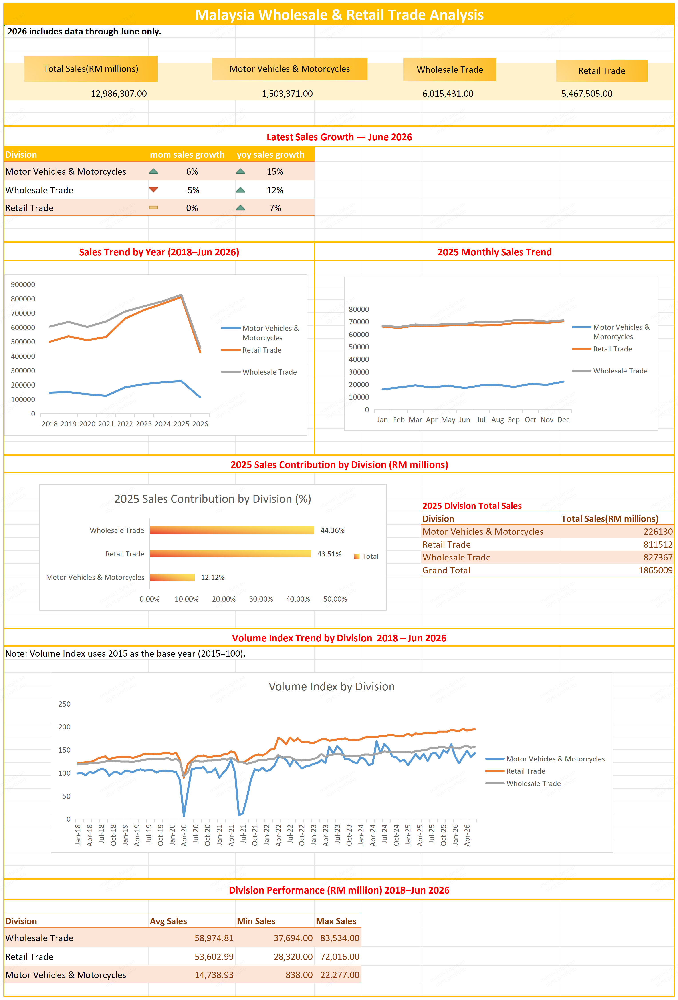

# malaysia-wholesale-retail-analysis

## Project Overview

This project analyzes Malaysia's Wholesale and Retail Trade data using SQL and spreadsheet analysis to identify sales trends, growth performance, division contribution, and volume index movements.

##  Dataset

**Dataset:** Wholesale & Retail Trade by Division (2 digit)

**Source:** [Malaysia Government Data - Department of Statistics Malaysia (DOSM)](https://open.dosm.gov.my/data-catalogue/iowrt_2d)

**Period:** January 2018 – June 2026

**License:** CC BY 4.0 

Note: The original dataset can be downloaded from the official source

## Key Analysis

- Data quality checks
- Sales trends & division performance
- 2025 sales contribution
- Latest YoY & MoM growth
- Volume Index trends

## Dashboard

## Tools

- SQL
- Excel-compatible spreadsheet tools (WPS)
- Pivot Tables
- Charts & Visualizations

## Key Findings

- Wholesale Trade generated the largest cumulative sales over the analysis period.
- Retail Trade showed strong long-term growth in the Volume Index.
- Motor Vehicles & Motorcycles showed greater volatility compared with the other divisions.
- Wholesale and Retail Trade contributed the majority of 2025 sales.

## Files

* [SQL Queries](./analysis.sql)
* [Spreadsheet Dashboard](./Wholesale_Retail_Analysis.xlsx)
* [PDF Dashboard](./Wholesale_Retail_Dashboard.pdf)
